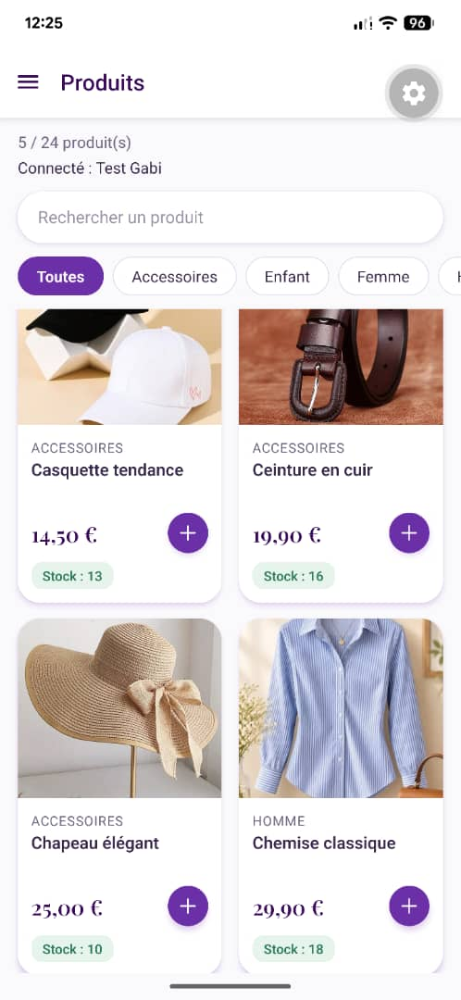
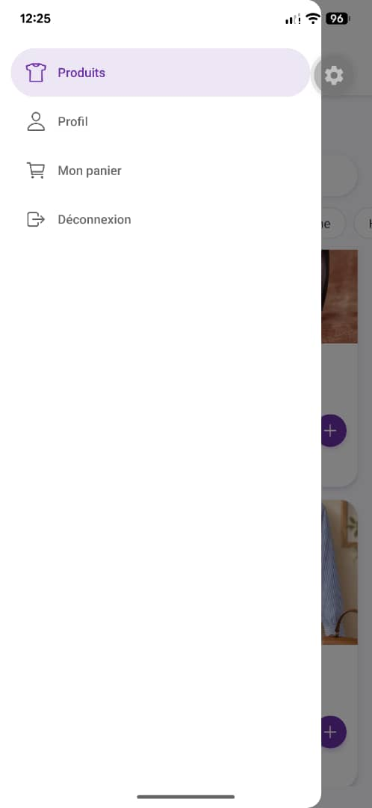
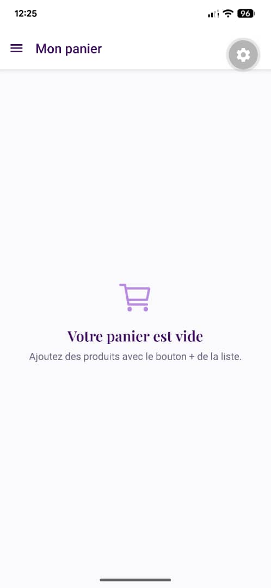
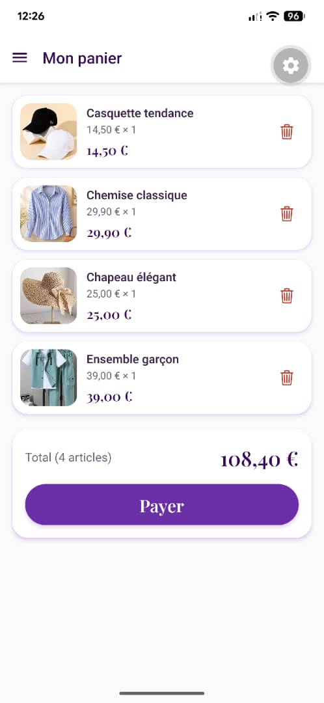

<h1 align="center">HOUSE OF CLOTHES</h1>

<p align="center">
  Application mobile de commerce de vêtements et d'accessoires.
</p>

<p align="center">
  <i>Affirmez votre style, trouvez vos coups de cœur.</i>
</p>

---

## Présentation du projet

House of Clothes est une application mobile développée avec 
React Native et Expo, destinée à la consultation de vêtements 
et d'accessoires ainsi qu'à la gestion d'un panier d'achat.

Ce projet personnel s'inscrit dans une démarche de mise en 
pratique et d'approfondissement de mes compétences en 
développement d'applications mobiles.

## Aperçu de l'application

### 1. Accueil et authentification

L'application propose une interface d'accueil permettant 
à l'utilisateur de créer un compte ou de se connecter 
à un compte existant.

<table>
  <tr>
    <th>Accueil</th>
    <th>Inscription</th>
    <th>Connexion</th>
  </tr>
  <tr>
    <td align="center">
      
    </td>
    <td align="center">
      
    </td>
    <td align="center">
      
    </td>
  </tr>
  <tr>
    <td>
      Présentation de la boutique et accès aux 
      interfaces d'authentification.
    </td>
    <td>
      Formulaire de création de compte avec 
      confirmation du mot de passe et acceptation des CGU.
    </td>
    <td>
      Interface de connexion à un compte existant 
      à partir d'une adresse email et d'un mot de passe.
    </td>
  </tr>
</table>

---

### 2. Catalogue et navigation

Le catalogue permet de consulter les articles disponibles, 
de rechercher un produit et de filtrer les résultats 
par catégorie.

Un menu latéral facilite la navigation entre les 
différentes sections de l'application.

<table>
  <tr>
    <th>Catalogue de produits</th>
    <th>Liste des articles</th>
    <th>Menu de navigation</th>
  </tr>
  <tr>
    <td align="center">
      
    </td>
    <td align="center">
      
    </td>
    <td align="center">
      
    </td>
  </tr>
  <tr>
    <td>
      Recherche de produits, filtrage par catégorie 
      et accès à l'ajout de nouveaux articles.
    </td>
    <td>
      Affichage des produits sous forme de cartes 
      avec leurs images, prix et stocks disponibles.
    </td>
    <td>
      Navigation latérale vers les produits, 
      le profil, le panier et la déconnexion.
    </td>
  </tr>
</table>

---

### 3. Gestion du panier

L'utilisateur peut ajouter des articles à son panier, 
consulter les produits sélectionnés et les retirer.

Une fenêtre modale confirme l'ajout d'un produit 
et permet de poursuivre les achats ou d'accéder 
directement au panier.

<table>
  <tr>
    <th>Panier vide</th>
    <th>Confirmation d'ajout</th>
    <th>Panier d'achat</th>
  </tr>
  <tr>
    <td align="center">
      
    </td>
    <td align="center">
      
    </td>
    <td align="center">
      
    </td>
  </tr>
  <tr>
    <td>
      Affichage conditionnel lorsque le panier 
      ne contient aucun article.
    </td>
    <td>
      Fenêtre modale de confirmation après 
      l'ajout d'un produit au panier.
    </td>
    <td>
      Récapitulatif des articles sélectionnés, 
      suppression des produits et calcul du montant total.
    </td>
  </tr>
</table>

---

## Fonctionnalités

- Inscription et connexion des utilisateurs
- Navigation entre les différents écrans
- Affichage dynamique du catalogue de produits
- Recherche de produits
- Filtrage par catégorie
- Affichage des stocks disponibles
- Ajout de produits au panier
- Suppression de produits du panier
- Calcul du montant total du panier
- Affichage conditionnel
- Fenêtres modales de confirmation
- Menu de navigation latéral

## Technologies utilisées

<p>
  
  
  
  
</p>

## Installation et lancement

Cloner le dépôt :

```bash
git clone https://github.com/Gaberte/Projet-Personel-REACT.Native.git
```

Accéder au projet :

```bash
cd Projet-Personel-REACT.Native
```

Installer les dépendances :

```bash
npm install
```

Lancer l'application :

```bash
npx expo start
```

## État du projet

Projet personnel en cours de développement 
et d'amélioration continue.

## Auteur

**Gaberte HOUESSOU**

Développement web et conception d'applications.

[Profil GitHub](https://github.com/Gaberte)
